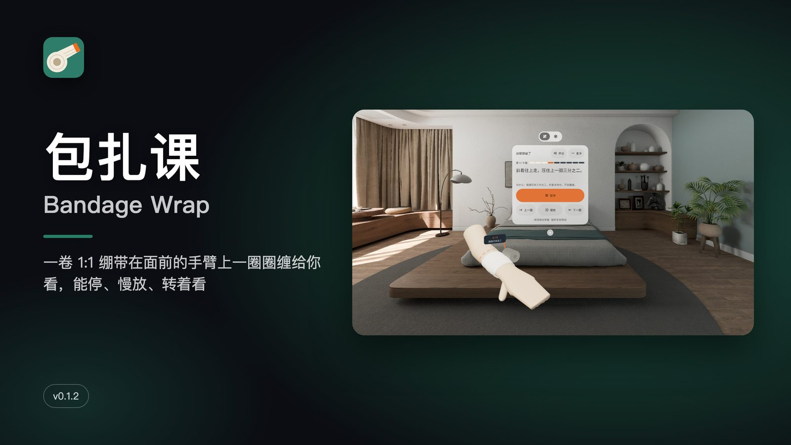
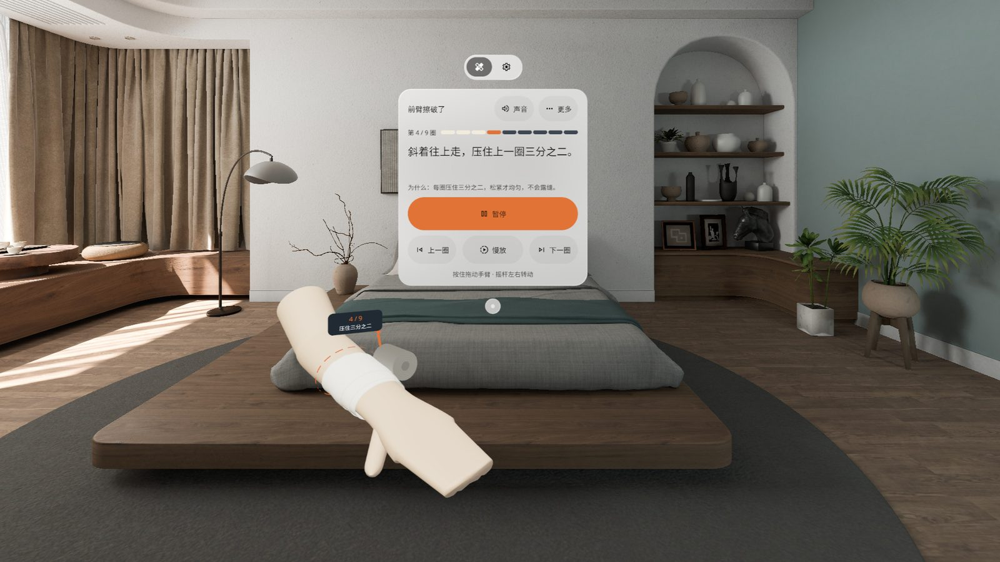
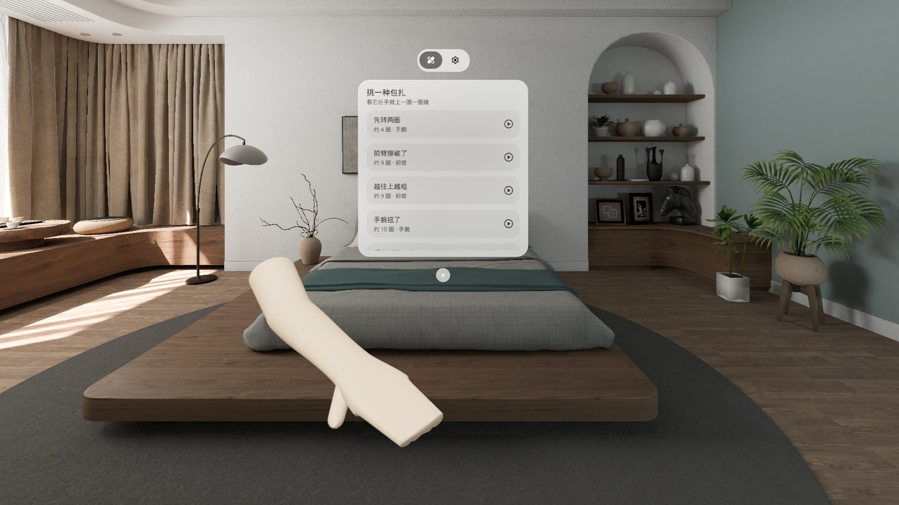
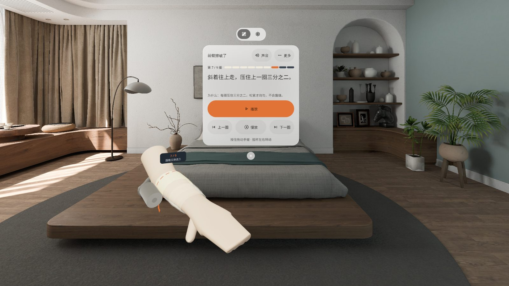
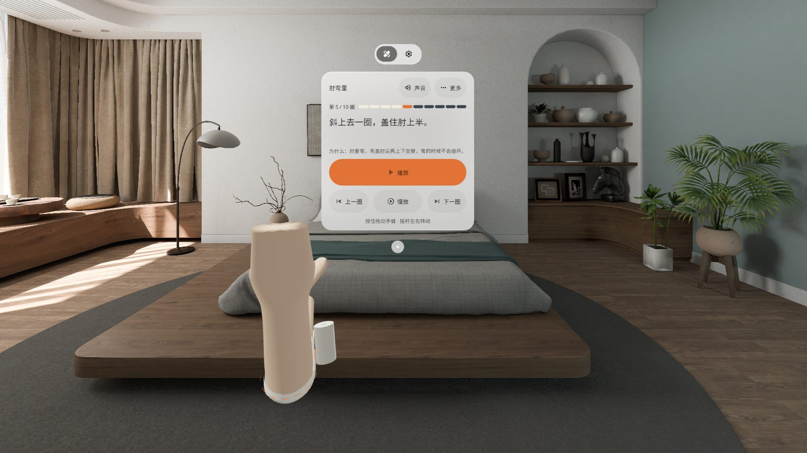
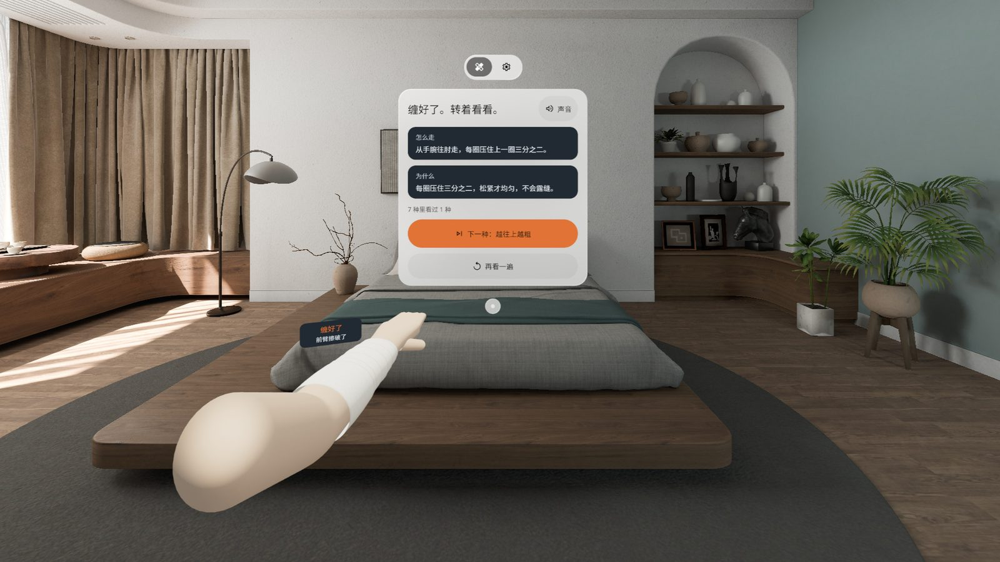
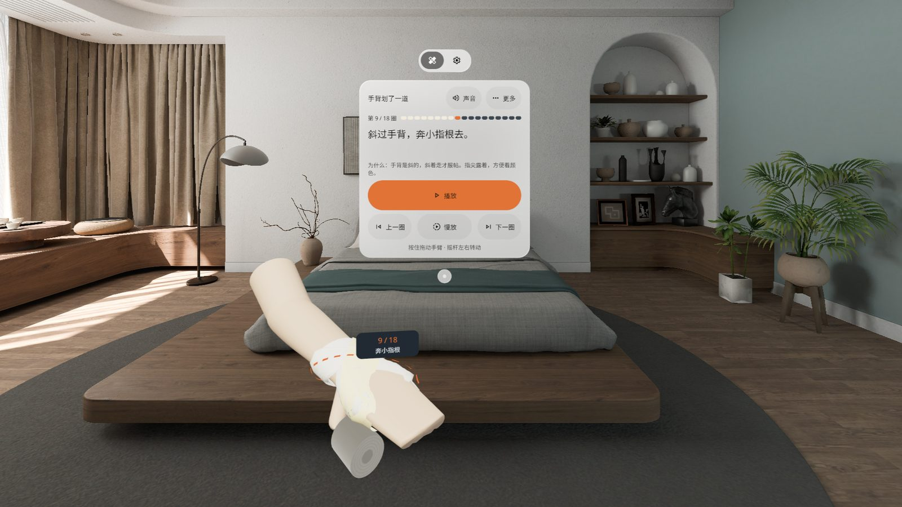

# Bandage Wrap · 包扎课



Watch seven arm bandage wraps go round a life-size arm on your desk, one turn at a time — pause, slow it down, step
back, turn the arm round, see the layers. PICO OS 6 (Full Space, passthrough), Kotlin + PICO Spatial SDK 6.1.9.

挑一种包扎，一卷 1:1 的绷带就在你面前桌上的手臂上一圈一圈缠给你看。能停、能慢放、能转着看，每一圈一句话讲它为什么这样走。

Technique only — not first aid training. Steps follow public St John Ambulance first-aid guides (rewritten) and common
nursing technique. Not affiliated with or endorsed by St John Ambulance. 与 St John Ambulance 无关联，未获其认可。

## What it does · 功能

- **Seven wraps · 七种包扎**: two turns to start, forearm spiral, reverse spiral, wrist figure-8, back-of-hand figure-8,
  thumb spica, elbow figure-8. 起手两圈、前臂螺旋、反折螺旋、手腕八字、手背八字、拇指人字、肘八字。
- **Turn by turn · 逐圈演示**: 3 s per turn (6 s slowed down), back / next turn, watch again; one line per turn on why it
  goes that way. 每圈 3 秒、慢放 6 秒，上一圈 / 下一圈 / 再看一遍，每圈一句话讲为什么。
- **Look from any side · 转着看**: drag the arm, turn it with the stick, or spin it once; see-through shows how the
  layers overlap. 拖动手臂、摇杆转动、自动转一圈；透视开关看下面几层怎么压。
- **On my own arm (optional) · 放到我手臂上（可选）**: line the arm up with yours once by hand tracking, then it locks.
  手追踪对位一次后锁住。
- Gaze + pinch or controller ray; Chinese / English; offline, no account, no permissions.
  眼手捏合或手柄射线；中英双语；全离线，不需要账号和权限。

## Screenshots · 截图

| | |
|---|---|
|  |  |
| Forearm spiral, turn 4 / 9 · 前臂螺旋第 4 圈 | Pick a wrap · 挑一种包扎 |
|  |  |
| See-through layers · 透视看层叠 | Elbow figure-8 · 肘八字 |
|  |  |
| Done — turn it round · 缠好了转着看 | Back-of-hand figure-8 · 手背八字 |

Screenshots are from the PICO emulator, driven by debug commands — not a recording of real hand gestures.
截图是模拟器里由调试命令驱动拍的，**非真实手势录像**。

Demo video: to be added (the emulator kept crashing on this machine). 演示视频待补（本机模拟器内存不足反复崩溃，还没录上）。

## Install · 安装

```bash
adb install -r BandageWrap-v0.1.2.apk
pico-cli app launch io.embodit.bandagewrap
```

The APK on the Release page is the unsigned `assembleRelease` build. Build it yourself:
Release 页面上的 APK 是 `assembleRelease` 出的未签名包。自己构建：

```bash
./gradlew assembleRelease   # app/build/outputs/apk/release/app-release-unsigned.apk
./gradlew assembleDebug     # debug build with the debug command receiver (tools/dev.sh)
```

## Known limits · 已知问题

- The arm is a parametric model, not a realistic scan. 手臂是参数化模型，不是写实模型。
- The bandage rustle is a CC0 paper-slide recording (Kenney). 绷带摩擦声是 Kenney 的 CC0 纸张摩擦录音。
- Not yet checked on a headset (controller B mapping, stick, hand-tracking alignment, sound). 还没在真机上验证。

## Credits · 致谢

Fonts: Noto Sans / Noto Sans SC (SIL OFL 1.1). Sounds: Kenney (CC0). Steps rewritten from public St John Ambulance
first-aid guides; not affiliated with or endorsed by St John Ambulance or Kenney.
字体 Noto Sans / Noto Sans SC（SIL OFL 1.1）；音效 Kenney（CC0）；步骤参考 St John Ambulance 公开急救指引并改写；与 St John
Ambulance、Kenney 无关联，未获其认可。

Developer notes: [AGENTS.md](AGENTS.md).
